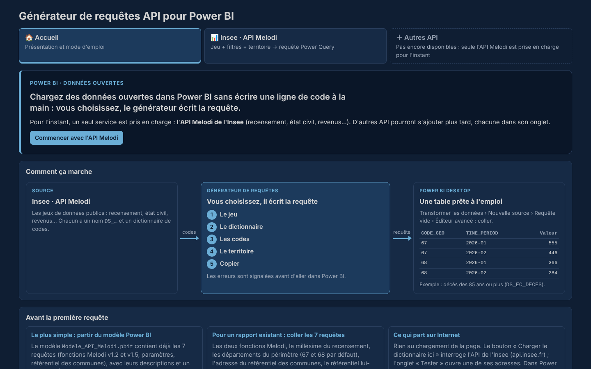
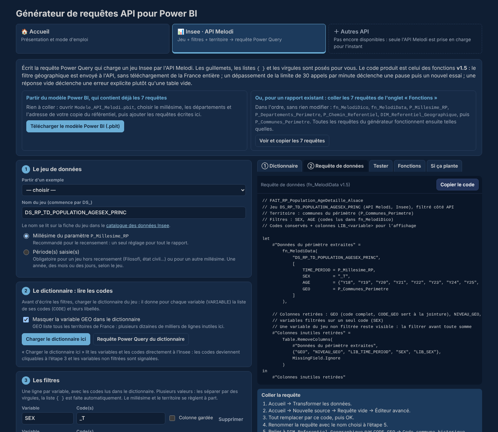
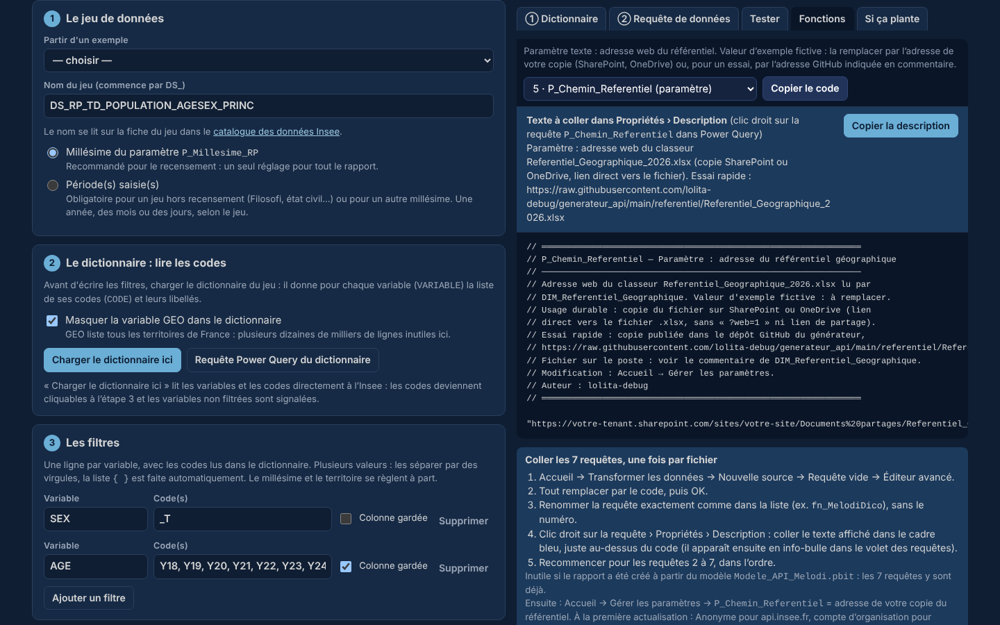

# Générateur de requêtes API pour Power BI

Une page HTML qui écrit à votre place les requêtes Power Query pour charger des données ouvertes dans Power BI. Vous choisissez le jeu, les codes et le territoire ; le générateur écrit la requête, avec les guillemets, les listes `{ }` et les virgules au bon endroit, et signale les erreurs avant d'aller dans Power BI.

> **Pour l'instant, une seule API est prise en charge : l'[API Melodi de l'Insee](https://www.insee.fr/fr/information/8184173)** (recensement, état civil, revenus…). L'outil est conçu pour accueillir d'autres API plus tard, chacune dans son onglet (voir la [feuille de route](#feuille-de-route)).

Le dépôt fournit aussi un **référentiel géographique des communes françaises 2026** (communes actuelles et historiques, avec leurs zonages), prêt à relier aux données Melodi.

**Essayer en ligne :** [le générateur](https://lolita-debug.github.io/generateur_api/)



Une présentation en 14 diapositives, [`Generateur_API_comprendre_l_outil.pptx`](Generateur_API_comprendre_l_outil.pptx), résume l'outil, le référentiel et la mise en route.

## Sommaire

- [Ce que fait l'outil](#ce-que-fait-loutil)
- [Utiliser l'outil](#utiliser-loutil)
- [Le référentiel géographique](#le-référentiel-géographique)
- [Ce qui part sur Internet](#ce-qui-part-sur-internet)
- [Limites connues](#limites-connues)
- [Si ça plante](#si-ça-plante)
- [Points à vérifier](#points-à-vérifier)
- [Alternatives](#alternatives)
- [Feuille de route](#feuille-de-route)
- [Historique](#historique)
- [Structure du dépôt](#structure-du-dépôt)
- [Sources et crédits](#sources-et-crédits)
- [Licences](#licences)

## Ce que fait l'outil

| Étape | Ce que vous faites | Ce que fait le générateur |
|---|---|---|
| 1. Le jeu | Saisir le nom du jeu (`DS_…`), lu dans le [catalogue des données Insee](https://catalogue-donnees.insee.fr), et la période | Vérifie le format du nom, propose le paramètre de millésime pour le recensement |
| 2. Le dictionnaire | Cliquer sur « Charger le dictionnaire ici » | Lit les variables et leurs codes à l'Insee ; les codes deviennent cliquables ; affiche les niveaux géographiques du jeu (France, département, commune, IRIS…) |
| 3. Les filtres | Choisir les codes de chaque variable | Signale les codes inexistants, les totaux mélangés aux détails, les variables oubliées |
| 4. Le territoire | Garder le périmètre de communes par défaut, ou saisir quelques territoires d'un même niveau (France, région, département, EPCI, commune, IRIS…) | Bloque un niveau absent du jeu (ex. périmètre de communes sur un jeu national), contrôle les codes géographiques |
| 5. La requête | Choisir codes ou libellés, et les colonnes à garder | Écrit la requête à coller dans Power BI |

Les filtres sont envoyés à l'API : seules les données utiles sont téléchargées, jamais la France entière pour n'en garder qu'un département.



## Utiliser l'outil

Deux façons de démarrer :

| Situation | Démarrage |
|---|---|
| Nouveau rapport | **Ouvrir le modèle [`modele/Modele_API_Melodi.pbit`](modele/Modele_API_Melodi.pbit)** : les 7 requêtes y sont déjà, avec leurs descriptions et un exemple. Power BI demande à l'ouverture le millésime du recensement, les départements du périmètre et l'adresse de votre copie du référentiel |
| Rapport existant | **Coller les 7 requêtes** de l'onglet « Fonctions » du générateur, une fois par fichier (voir ci-dessous) |

Dans les deux cas, **installer d'abord le référentiel des communes** (une fois) :

1. Télécharger [`referentiel/Referentiel_Geographique_2026.xlsx`](referentiel/Referentiel_Geographique_2026.xlsx).
2. Le déposer sur SharePoint ou OneDrive.
3. Copier son **lien direct** : ouvrir le fichier dans Excel (application de bureau), Fichier › Informations › Copier le chemin d'accès, puis retirer la fin `?web=1` si elle apparaît. Un lien de partage (« Copier le lien ») ne fonctionne pas.
4. Coller ce lien dans le paramètre `P_Chemin_Referentiel` (demandé à l'ouverture du modèle, ou Accueil › Gérer les paramètres). Sa valeur par défaut est une adresse d'exemple fictive : tant qu'elle n'est pas remplacée, le référentiel ne se charge pas.

Pour un simple essai, l'adresse de la copie publiée dans ce dépôt fonctionne aussi : `https://raw.githubusercontent.com/lolita-debug/generateur_api/main/referentiel/Referentiel_Geographique_2026.xlsx`. Elle est déconseillée pour un rapport durable : le rapport dépendrait de ce dépôt, et certains réseaux bloquent GitHub.

Ensuite :

1. **Ouvrir le générateur** : [en ligne](https://lolita-debug.github.io/generateur_api/), ou télécharger `generateur_api.html` et l'ouvrir dans le navigateur (double-clic). Aucune installation.
2. **Si vous partez d'un rapport existant : coller les 7 requêtes** de l'onglet « Fonctions », dans l'ordre, sans rien modifier. Pour chacune : Accueil › Transformer les données › Nouvelle source › Requête vide › Éditeur avancé, coller, puis renommer la requête exactement comme indiqué. Clic droit › Propriétés : coller la description proposée par le générateur ; elle s'affiche en info-bulle dans le volet des requêtes.

   | Requête | Rôle |
   |---|---|
   | `fn_MelodiDico` | Fonction (v1.2) : dictionnaire d'un jeu (codes → libellés, niveau géographique de chaque territoire), avec nouvel essai en cas de dépassement de la limite d'appels |
   | `fn_MelodiData` | Fonction (v1.5) : données d'un jeu, filtrées côté API, interrogées par paquets, avec nouvel essai en cas de dépassement de la limite d'appels ; erreur explicite si l'API ne renvoie rien |
   | `P_Millesime_RP` | Paramètre : millésime du recensement (`2023`) |
   | `P_Departements_Perimetre` | Paramètre : départements du périmètre (`67,68` par défaut) |
   | `P_Chemin_Referentiel` | Paramètre : adresse de votre copie du référentiel (valeur d'exemple fictive à remplacer) |
   | `DIM_Referentiel_Geographique` | Référentiel des communes, lu à l'adresse de `P_Chemin_Referentiel` |
   | `P_Communes_Perimetre` | Liste des communes du périmètre, au format attendu par l'API |

   Les deux fonctions portent leur propre documentation : dans Power Query, cliquer sur la fonction affiche sa description, ses paramètres et des exemples.

3. **À la première actualisation**, Power BI demande comment se connecter :

   | Source | Identifiants | Confidentialité |
   |---|---|---|
   | `api.insee.fr` | Anonyme | **Le même niveau que le référentiel** |
   | Référentiel sur SharePoint ou OneDrive | Compte d'organisation | Organisationnel (et donc Organisationnel aussi pour `api.insee.fr`) |
   | Référentiel sur GitHub (essai) | Anonyme | Public (et donc Public aussi pour `api.insee.fr`) |

   Deux niveaux différents provoquent une erreur `Formula.Firewall` : la liste des communes, issue du référentiel, est envoyée à l'Insee. Ces codes de communes sont des données publiques.
4. **Construire une requête** dans le générateur (étapes 1 à 5), la copier et la coller dans une nouvelle requête vide.
5. **Relier les données** à `DIM_Referentiel_Geographique` (relation un à plusieurs, côté « un » sur le référentiel). Le générateur indique la relation adaptée au niveau géographique :

   | Données au niveau | Relation |
   |---|---|
   | Commune (`COM`) | `CODE_GEO` → `Code commune historique` |
   | IRIS | `CODE_COMMUNE` (ajoutée par la requête) → `Code commune historique` |
   | Département, région, EPCI, arrondissement, aire d'attraction, bassin de vie | Pas de relation directe : le référentiel compte une ligne par commune. Pour les libellés, créer une petite table du niveau à partir des colonnes du référentiel (ex. `Code département`, `Libellé département`, doublons supprimés) |
   | France, zone d'emploi, unité urbaine, arrondissement municipal | Pas de relation avec le référentiel |

Pour changer de périmètre, modifier `P_Departements_Perimetre` (Accueil › Gérer les paramètres) : `2A,2B` pour la Corse, `971` pour la Guadeloupe. Vide, il couvre la France entière : environ 35 000 communes, 140 paquets d'appels, à éviter (voir [Limites connues](#limites-connues)).



### Publier dans le service Power BI

- Paramètres du modèle sémantique › Informations d'identification : `api.insee.fr` en Anonyme, en cochant **« Ignorer le test de connexion »** (la racine du site de l'API ne répond pas au test) ; le référentiel avec un compte d'organisation (SharePoint, OneDrive).
- Aucune passerelle n'est nécessaire, sauf si le référentiel est un fichier sur le poste.
- Changer de millésime ou de périmètre : Paramètres du modèle sémantique › Paramètres, puis actualiser.

L'outil est testé avec Google Chrome. Microsoft Edge, qui repose sur le même moteur, devrait fonctionner de la même façon ; Firefox et Safari n'ont pas été testés.

## Le référentiel géographique

Le fichier [`referentiel/Referentiel_Geographique_2026.xlsx`](referentiel/Referentiel_Geographique_2026.xlsx) contient un tableau Excel nommé `Communes` et une feuille « À propos » qui décrit chaque colonne.

| | |
|---|---|
| Contenu | 37 304 communes : 34 875 communes existant au 1er janvier 2026 et 2 429 communes historiques fusionnées depuis, chacune rattachée à sa commune actuelle |
| Couverture | France métropolitaine et départements d'outre-mer. Pas de collectivités d'outre-mer, pas d'arrondissements municipaux de Paris, Lyon et Marseille |
| Clé unique | `Code commune historique` (une commune qui existe toujours a son propre code dans les deux colonnes) |
| Zonages | Département, région, EPCI à fiscalité propre, arrondissement, canton-ville, aire d'attraction des villes 2020, bassin de vie 2022 |

**Pourquoi des communes historiques ?** Une donnée publiée dans une géographie plus ancienne porte parfois le code d'une commune qui a fusionné depuis. En reliant les données sur `Code commune historique`, elle retrouve sa commune actuelle au lieu de disparaître de la jointure.

**Retraitements du fichier d'origine** : nature « Métropoles (ME) » renseignée pour 22 métropoles qui figuraient en « Aucun (ZZ) » dans le fichier de départ (la Métropole de Lyon, collectivité à statut particulier, y est rangée par commodité) ; deux lignes fictives retirées (« étranger », « communes inconnues ») ; une espace parasite ; libellés vides en face d'un code « sans objet ». Le détail figure dans la feuille « À propos ».

## Ce qui part sur Internet

- **Au chargement de la page : rien.** Pas de police, de script ni de statistique chargés depuis Internet.
- **Dans le générateur** : le bouton « Charger le dictionnaire ici » interroge `api.insee.fr` ; l'onglet « Tester » ouvre une adresse de la même API. Rien d'autre n'est envoyé, et aucune donnée saisie ne quitte la page en dehors de ces appels.
- **Dans Power BI** : les requêtes appellent `api.insee.fr` (sans compte ni clé) et lisent le référentiel à l'adresse du paramètre `P_Chemin_Referentiel` (votre SharePoint ou OneDrive, ou GitHub pour un essai). La liste des communes du périmètre est envoyée à l'Insee comme filtre.

Les choix faits dans le générateur sont mémorisés dans le navigateur (stockage local), pour les retrouver à la prochaine ouverture.

## Limites connues

- **30 appels par minute.** C'est la limite de l'API Melodi en accès libre. Chaque paquet de 250 communes et chaque page de résultats compte pour un appel. En cas de dépassement (erreur 429), `fn_MelodiData` fait une pause puis réessaie, au plus 3 fois (20, 40 puis 60 secondes) : un grand périmètre reste lent, et peut finir en erreur. Ajouter des filtres de variables ou réduire `P_Departements_Perimetre`. La limite est partagée : plusieurs requêtes Melodi actualisées en même temps, plus l'appel au dictionnaire que fait chacune, la consomment ensemble.
- **Pagination de l'API peu fiable sur gros volume** (constat d'octobre 2026) : pages dupliquées ou sautées lors d'une extraction France entière sans filtre. Les doublons exacts sont supprimés, mais une page sautée ne se récupère pas : toujours passer un filtre géographique.
- **Millésime de la géographie.** `P_Communes_Perimetre` envoie à l'API les codes des communes actuelles, ce qui convient aux jeux publiés dans la géographie en vigueur (millésime visible dans `GEO`, ex. `2026-COM-67482`). Pour un jeu qui serait publié dans une géographie plus ancienne, utiliser « Territoires précis ». Dans tous les cas, la jointure avec `DIM_Referentiel_Geographique` sur `Code commune historique` rattache les anciennes communes à leur commune actuelle.
- **Tous les jeux ne sont pas publiés à la commune.** Un jeu n'existe qu'à certains niveaux : national seulement (comptes nationaux, par exemple), départemental, communal, ou infracommunal (IRIS). Ces niveaux figurent dans l'onglet Métadonnées du catalogue Insee (« Maille(s) géographique(s) ») et dans le dictionnaire du jeu, qui donne le niveau de chaque territoire publié. Une fois le dictionnaire chargé (étape 2), le générateur affiche les niveaux du jeu et bloque une combinaison impossible (périmètre de communes sur un jeu sans niveau commune). Dans Power BI, une requête qui ne renvoie rien s'arrête sur l'erreur « API Melodi : aucune donnée ».
- **IRIS : pas de référentiel des IRIS.** Pour un jeu IRIS, le périmètre est construit par la requête à partir du dictionnaire du jeu : les IRIS des communes du périmètre, plus les communes non découpées en IRIS (publiées au niveau commune). Un filtre sur une commune découpée en IRIS ne renvoie rien : c'est pourquoi les codes IRIS sont envoyés un par un. La colonne `CODE_COMMUNE` (5 premiers caractères du code IRIS) relie les données au référentiel, pour les agréger par commune, EPCI ou département ; les noms d'IRIS ne sont pas fournis. Paris, Lyon et Marseille ne sont pas couverts : leurs IRIS dépendent des arrondissements municipaux, absents du référentiel.
- **Données supracommunales** (département, EPCI, région…) : `CODE_GEO` contient alors un code de ce niveau, sans relation directe avec le référentiel, qui compte une ligne par commune. Pour les libellés, créer une petite table du niveau à partir des colonnes du référentiel (ex. `Code département`, `Libellé département`, doublons supprimés).
- **Croisements sans effectif** : une combinaison nulle peut ne pas être renvoyée par l'API. La traiter comme 0.
- **Totaux et détails dans les mêmes colonnes** (`_T`, sous-totaux comme `1T2`) : une seule modalité par variable avant de sommer. Le générateur le signale.
- **Arrondissements municipaux** : Paris, Lyon et Marseille figurent dans le référentiel au niveau de la commune (75056, 69123, 13055). Une donnée publiée par arrondissement municipal ne trouvera pas de correspondance.
- **Le modèle .pbit et le générateur contiennent le même code.** Le générateur fait référence ; la version des fonctions du modèle est indiquée dans [`modele/README.md`](modele/README.md).
- **Le référentiel est à héberger soi-même** (SharePoint, OneDrive) et son adresse à renseigner dans `P_Chemin_Referentiel`. La copie de ce dépôt sur GitHub dépanne pour un essai. Pour un fichier sur le poste, remplacer `Web.Contents(P_Chemin_Referentiel)` par `File.Contents("…")` dans `DIM_Referentiel_Geographique` : une passerelle sera alors nécessaire pour actualiser dans le service.
- **« Garder seulement les colonnes utiles » retire, il ne sélectionne pas** : la requête retire `GEO`, `NIVEAU_GEO` et les variables filtrées sur un seul code. Une variable du jeu oubliée dans les filtres reste donc visible (ex. `SEX` avec Femme, Homme et Total) : la filtrer avant toute somme. Le générateur la signale quand le dictionnaire est chargé.
- **Pas de tests automatiques.** Le code Power Query est vérifié à la main dans Power BI Desktop.

## Si ça plante

L'onglet « Si ça plante » du générateur détaille les symptômes et leurs solutions. Les plus fréquents :

| Symptôme | Solution |
|---|---|
| Erreur « API Melodi : aucune donnée » | L'API n'a rien renvoyé. Le plus souvent : jeu non publié au niveau demandé (ex. jeu national filtré sur des communes : « Territoires précis », `FRANCE`, code `F`) ; sinon période pas encore publiée, code de filtre inexistant, ou `P_Departements_Perimetre` sans département reconnu. Charger le dictionnaire : il affiche les niveaux et les codes du jeu |
| `Expression.Error` : nom introuvable | Une des 7 requêtes manque ou n'a pas le nom exact |
| Erreur « API Melodi : trop d'appels », ou actualisation très longue | Limite de 30 appels par minute : réduire le périmètre ou ajouter des filtres |
| `Formula.Firewall` | Même niveau de confidentialité pour `api.insee.fr` et pour la source du référentiel (Organisationnel avec SharePoint ou OneDrive) |
| Référentiel inaccessible | `P_Chemin_Referentiel` contient encore l'adresse d'exemple, ou un lien de partage au lieu du lien direct vers le fichier |
| Service : identifiants refusés pour `api.insee.fr` | Cocher « Ignorer le test de connexion » |
| « Charger le dictionnaire ici » échoue | Utiliser la requête Power Query du dictionnaire |

## Points à vérifier

Vérifiés sur l'API réelle (novembre 2026) : le dictionnaire se charge depuis la page ; chaque valeur `GEO` du dictionnaire porte son niveau (`type`) et son identifiant (`2026-COM-2A117`) ; un jeu IRIS filtré sur une commune découpée en IRIS ne renvoie rien. Restent à confirmer :

| Point | Hypothèse retenue | Comment vérifier |
|---|---|---|
| Filtre IRIS | `GEO=IRIS-<code à 9 caractères>`, sur le modèle de `GEO=COM-67482` | Onglet Tester avec un jeu `…_IRIS`, dictionnaire chargé : les adresses de test utilisent de vrais codes IRIS |
| Référentiel sur SharePoint + API Insee | Pas d'erreur `Formula.Firewall` quand les deux sources ont le même niveau de confidentialité | Actualiser la requête d'exemple du modèle avec le référentiel sur SharePoint |

Un retour sur ces points est bienvenu (issue GitHub).

## Alternatives

| Outil | En bref |
|---|---|
| [Explorateur du catalogue des données Insee](https://catalogue-donnees.insee.fr) | Permet de filtrer un jeu à l'écran et de récupérer l'URL d'API correspondante ; il reste à écrire la requête Power Query |
| [Package R `melodi`](https://cran.r-project.org/web/packages/melodi/index.html), publié par l'Insee | Pour travailler en R : catalogue, dictionnaires, données filtrées ou fichiers complets |

Ce que ce générateur ajoute pour un usage Power BI : un modèle .pbit prêt à l'emploi, des requêtes Power Query documentées (description en info-bulle, aide des fonctions dans Power Query), les contrôles avant chargement (codes inexistants, totaux mélangés, variables oubliées), l'interrogation par paquets et un référentiel géographique prêt à relier.

## Feuille de route

Pistes non engagées :

- **D'autres API publiques**, chacune dans son onglet. Aucune n'est disponible pour l'instant.
- **Liste des jeux du catalogue** dans le générateur, pour éviter de recopier le nom `DS_…`.

## Historique

| Version | Changements |
|---|---|
| 1.0.0 (novembre 2026) | Première version publiée. Fonctions Melodi `fn_MelodiDico` v1.2 et `fn_MelodiData` v1.5 : filtre géographique envoyé à l'API, interrogation par paquets de 250, pause et nouvel essai en cas de dépassement de la limite d'appels, erreur explicite si l'API ne renvoie rien. Modèle Power BI (.pbit) avec les 7 requêtes déjà en place et documentées. Référentiel France entière à héberger soi-même, adresse en paramètre, périmètre réglable par département. Colonnes inutiles retirées sans masquer une variable oubliée. Niveaux géographiques lus dans le dictionnaire : niveau absent du jeu bloqué, 12 niveaux proposés (dont France, IRIS, AAV, bassins de vie), périmètre d'IRIS construit à partir du dictionnaire, colonne `CODE_COMMUNE` pour les données IRIS. Périodes du jeu cliquables ; nom de requête et filtres remis à zéro au changement de jeu. Outil 100 % hors ligne au chargement (polices système). Thème sombre accessible |

## Structure du dépôt

```
├── generateur_api.html                 Le générateur, autonome
├── index.html                          Redirection vers le générateur (adresse courte du site)
├── Generateur_API_comprendre_l_outil.pptx   Présentation de l'outil (14 diapositives)
├── modele/
│   ├── Modele_API_Melodi.pbit          Modèle Power BI avec les 7 requêtes déjà en place
│   └── README.md                       Contenu du modèle et procédure de mise à jour
├── referentiel/
│   └── Referentiel_Geographique_2026.xlsx   Communes actuelles et historiques, avec zonages
├── docs/                               Captures d'écran du README
├── .gitignore
├── LICENSE
└── README.md
```

## Sources et crédits

| Élément | Source | Conditions |
|---|---|---|
| Données statistiques | [API Melodi](https://portail-api.insee.fr/), Insee | Licence Ouverte 2.0 |
| Référentiel géographique | Insee, Code officiel géographique 2026 et zonages d'étude ; retraitement lolita-debug | Licence Ouverte 2.0 |
| Conception, code et relecture | lolita-debug, avec l'assistance de Claude (Anthropic) | — |

## Licences

- **Le générateur** (`generateur_api.html`) est publié sous licence MIT : voir [LICENSE](LICENSE).
- **Le référentiel géographique** est diffusé sous [Licence Ouverte 2.0](https://www.etalab.gouv.fr/licence-ouverte-open-licence/), comme les données Insee dont il est issu : réutilisation libre, y compris commerciale, en mentionnant la source (« Insee, retraitement lolita-debug »).
